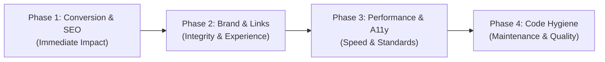

# Bali Asri Tour — Website Remediation Action Plan & Next Steps

This document outlines the phased, prioritized roadmap for executing fixes identified during the website audit.

---

## 🎯 Executive Checklist & Phase Overview



---

## Phase 1: Conversion & SEO Foundations (High Priority)

Critical fixes to ensure traveler inquiries are captured reliably and all 74 static pages are properly indexed by search engines.

### 1.1 Connect Inquiry Forms to Live Dispatch
- [ ] **Create API Route**: Create `app/api/inquiry/route.ts` to receive form submissions and forward them via:
  - Option A: Webhook dispatch to `INQUIRY_WEBHOOK_URL` (Slack, Make, Zapier, or Google Sheets).
  - Option B: Transactional email using Resend / SendGrid / Nodemailer.
- [ ] **Wire `components/forms/ContactForm.tsx`**:
  - Replace `setTimeout` simulation with `fetch('/api/inquiry', ...)`.
  - Provide an automatic WhatsApp redirect fallback on success.
- [ ] **Wire `components/forms/BlogInquiryForm.tsx`**:
  - Replace `setTimeout` simulation with real submission handling.

### 1.2 Implement Dynamic `sitemap.ts` and `robots.ts`
- [ ] **Create `app/sitemap.ts`**:
  - Dynamically import `getAllTours()`, `getAllBlogPosts()`, `TOUR_CATEGORIES`, and static pages.
  - Generate full URLs with `<lastModified>`, `<changeFrequency>`, and `<priority>`.
- [ ] **Create `app/robots.ts`**:
  - Allow all crawlers (`*`).
  - Reference `https://bali-asri-tour.vercel.app/sitemap.xml`.

### 1.3 Add Schema.org / JSON-LD Structured Data
- [ ] **Organization / TravelAgency Schema**: Inject in `app/layout.tsx`:
  - Type: `TravelAgency` / `LocalBusiness`
  - Name, Logo, Address, Coordinates, Phone, PriceRange (`$$`), OpeningHours, SameAs links.
- [ ] **Product & Tour Package Schema**: Inject in `app/[slug]/page.tsx`:
  - Type: `Product` / `TouristAttraction`
  - Title, Description, Image, Offers (`priceUSD`, `currency: USD`), AggregateRating (`ratingValue: 5.0`, `reviewCount`).
- [ ] **FAQPage Schema**: Inject in `app/faq/page.tsx`:
  - Structured Q&A pairs for Google rich snippet display.

### 1.4 Resolve Duplicate Blog Routing
- [ ] **Specify Canonical URLs**: In `generateMetadata` for both `app/[slug]/page.tsx` and `app/blogs/[slug]/page.tsx`:
  ```typescript
  alternates: {
    canonical: `https://bali-asri-tour.vercel.app/blogs/${slug}`,
  }
  ```
- [ ] Alternatively, redirect `/[slug]` to `/blogs/[slug]` when the slug resolves to a blog post.

---

## Phase 2: Brand Consistency, Navigation & Legal Harmony

Eliminating obsolete domain references, repairing the car rental navigation flow, and aligning legal policies.

### 2.1 Purge Residual Legacy Domain References
- [ ] **Fix Social Share Buttons**: Update `app/[slug]/page.tsx` and `BlogPostDetail.tsx` from `https://bali-agung-tours.com/...` to `https://bali-asri-tour.vercel.app/${slug}/`.
- [ ] **Update Contact Email**: Change `agung@bali-agung-tours.com` and `info@bali-agung-tours.com` in `data/navigation.ts` and pages (`about`, `supplier`, `terms`, `privacy`, `faq`) to a consistent domain email (or update tests asserting this value).
- [ ] **Remove Defunct Google+ Links**:
  - Delete `googlePlus` property from `data/navigation.ts`.
  - Remove dead `G+` anchor link (`https://plus.google.com`) in `SiteFooter.tsx`.
- [ ] **Upgrade TripAdvisor URL**: Change `http://www.tripadvisor.co.id/...` to `https://...` in `data/navigation.ts`.
- [ ] **Fix ASITA Blog Slug**: In `SiteFooter.tsx`, align slug with `bali-asri-tour-officially-recognized-asita-member` or existing data slug.
- [ ] **Update `.env.example`**: Set `NEXT_PUBLIC_SITE_URL=https://bali-asri-tour.vercel.app`.

### 2.2 Restore Unlinked Car Rental Catalog
- [ ] **Update `MAIN_NAVIGATION` in `data/navigation.ts`**:
  - Add `Private Car Hire with Driver` (`href: '/book-a-car/'`) as a primary child under `BOOK A CAR`.
  - Keep `Airport & Hotel Shuttle` (`href: '/bali-airport-hotel-shuttle/'`).
- [ ] **Consolidate Duplicate Pages**: Redirect or merge `app/book-car-in-bali/page.tsx` into `app/book-a-car/page.tsx`.

### 2.3 Reconcile Policy & Rating Discrepancies
- [ ] **Cancellation Policy**: Harmonize `Terms & Conditions` with the homepage value proposition ("Free cancellation up to 24 hours prior to tour departure").
- [ ] **TripAdvisor Ratings**: Standardize all copy across Homepage (4.9 / 1,192 reviews) vs Navigation/Footer/Review Gallery (5.0 / 1,450+ reviews).
- [ ] **Insurance Terms**: Harmonize "Liability Insurance" in `app/about/page.tsx` with `app/faq/page.tsx` to clearly distinguish vehicle passenger liability insurance from personal travel insurance.

---

## Phase 3: Performance, Security & Accessibility

Boosting Core Web Vitals, securing HTTP communications, and achieving WCAG compliance.

### 3.1 Optimize Heavy Media & LCP Hero Banner
- [ ] **Compress Logo**: Convert `public/images/logo-emblem.png` (1,003 KB) to an optimized WebP or compressed PNG under 25 KB.
- [ ] **Homepage Hero LCP**: In `app/page.tsx`, replace CSS `backgroundImage` with Next.js `<Image priority fill className="object-cover" sizes="100vw" />`.
- [ ] **Clean Abandoned Assets**: Delete empty 0-byte file `public/images/blog-2.png`.

### 3.2 Fix Accessibility (A11y) & WCAG AA Contrast
- [ ] **Color Contrast**: Replace low-contrast gold text (`#FFB200` / `#ffb703`) on white surfaces across `/about`, `/charity`, `/our-team`, `/bali-airport-hotel-shuttle`, and `/blogs` with accessible dark amber (`#855A00`) or brand green (`#308C17`).
- [ ] **Functional Interactive Elements**:
  - Remove `pointer-events-none` on homepage gallery arrows and attach carousel/scroll behavior.
  - Implement expand/modal behavior or link for "Read more" buttons on TripAdvisor review cards.

### 3.3 Security Headers & Global Error Boundary
- [ ] **HTTP Headers**: Add security headers in `next.config.mjs`:
  - `Content-Security-Policy`
  - `Strict-Transport-Security: max-age=63072000; includeSubDomains; preload`
  - `X-Frame-Options: SAMEORIGIN`
  - `X-Content-Type-Options: nosniff`
  - `Referrer-Policy: strict-origin-when-cross-origin`
  - `Permissions-Policy: camera=(), microphone=(), geolocation=()`
- [ ] **Create `app/error.tsx`** and `app/global-error.tsx`:
  - Graceful crash recovery with "Try again" and direct WhatsApp support CTA.

---

## Phase 4: Code Cleanliness & Developer Experience

- [ ] **ESLint Setup**: Add `eslint` and `eslint-config-next` to `devDependencies`, add `.eslintrc.json` so `npm run lint` works in CI/CD without prompting.
- [ ] **Remove Unused State**: Clean up declared but unused `PARTNERS` array in `OurTeamPage`, `CharityPage`, and `PrivacyPolicyPage`.
- [ ] **Remove Debug Slug**: Delete `'test': '/bali-tour-package/'` in `app/category/[slug]/page.tsx`.
- [ ] **Move Workspace File**: Move or gitignore `tests/frontend/Bali Asri Tour.code-workspace`.
- [ ] **Fix Typographical Errors**:
  - `Bussiness Licence : ` -> `Business License : ` in `SiteFooter.tsx`.
  - `abolutely` -> `absolutely` in `privacy-policy/page.tsx`.
  - `Goverment`, `aleady`, `actvites`, `date date` in `terms-conditions/page.tsx`.
  - `GET FREE QOUTE` -> `GET FREE QUOTE` in `bali-airport-hotel-shuttle/page.tsx`.
  - `enviroment`, `Bal Clean` -> `environment`, `Bali Clean` in `charity/page.tsx`.
