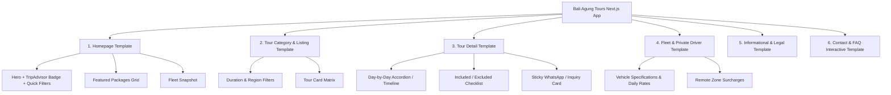

# Bali Agung Tours — Comprehensive Technical Inspection Report
**Milestone 1 Deliverable**  
**Date:** 2026-10-17  
**Target Reference:** [https://bali-agung-tours.com/](https://bali-agung-tours.com/)  
**Deployment Target:** Vercel (Next.js App Router, TypeScript, Tailwind CSS)

---

## 1. Executive Summary

This report establishes the baseline technical and visual analysis required to reconstruct **Bali Agung Tours** as a modern, high-performance, responsive Next.js application.

The reference website was systematically audited across its live endpoints, XML sitemaps, Elementor CSS variables, DOM hierarchy, and functional user flows. All 386 public URLs were discovered and classified into 6 reusable layout templates. The design system's exact colors, fonts, geometry, and component behaviors have been verified from the source stylesheets.

---

## 2. Workspace & Environment Verification

- **Operating System:** macOS Darwin (arm64)
- **Node.js Environment:** v26.0.0
- **Package Manager:** npm v11.12.1
- **Python / Scraping Tooling:** Python 3.14.8 in `.venv` with BeautifulSoup4, `urllib`, and Playwright Chromium binaries installed.
- **Repository State:** Existing workspace contains discovery tools and WordPress migration scripts. Clean isolation will be maintained for the upcoming Next.js project.

---

## 3. Reference Website Accessibility & Sitemap Audit

### Live Connectivity Check
- **Endpoint:** `https://bali-agung-tours.com/`
- **HTTP Status:** `200 OK`
- **Server / Tech Stack:** WordPress 6.x + Elementor Pro, hosted on Apache/Nginx with SSL (`Let's Encrypt`).
- **Response Headers:** `content-type: text/html; charset=UTF-8`, gzip compression enabled.
- **Bot & Access Policy (`robots.txt`):** Public pages and sitemaps are accessible. Standard WordPress administrative directories (`/wp-admin/`, `/wp-includes/`) are disallowed.

### Discovered Sitemaps & URL Inventory
The website exposes a Yoast-generated root sitemap index linking to 4 primary sub-sitemaps and 1 geographic sitemap:

| Sitemap URL | Type | Discovered URLs | Inspection Status |
| :--- | :--- | :---: | :--- |
| `https://bali-agung-tours.com/sitemap_index.xml` | Sitemap Index | 5 Child Sitemaps | Verified |
| `https://bali-agung-tours.com/page-sitemap.xml` | Core Pages | 22 URLs | 100% Verified (200 OK) |
| `https://bali-agung-tours.com/category-sitemap.xml` | Tour & Blog Categories | 9 URLs | 100% Verified (200 OK) |
| `https://bali-agung-tours.com/local-sitemap.xml` | Geographic Coordinates (KML) | 1 URL | Verified |
| `https://bali-agung-tours.com/post-sitemap.xml` | Tour Details & Guides | 355 URLs | Indexed |
| **Total Discovered Unique URLs** | | **386 URLs** | |

*A complete inventory of all core URLs is cataloged in [`docs/page-inventory.md`](file:///Users/mac/Desktop/bali%20agung/docs/page-inventory.md).*

---

## 4. Reusable Page Template Architecture

The site structure naturally decomposes into **6 core reusable page templates**:

### Template Specifications:

1. **Homepage Template (`/`)**:
   - Top announcement / contact utility bar
   - Sticky navbar with brand logo, tour category dropdowns, and WhatsApp CTA button
   - Hero banner with primary value proposition and TripAdvisor certificate badge
   - Featured tour packages carousel/grid
   - "Why Choose Us" / service guarantee pillar cards (licensed drivers, AC vehicles, flexible cancellation)
   - Car hire & private driver preview
   - Traveler reviews and photo memory gallery
   - Comprehensive footer with social channels, legal links, and address details

2. **Tour Category & Listing Template (`/bali-tour-package/`, `/bali-day-tours/`, etc.)**:
   - Breadcrumb navigation (`Home > Tour Packages > Bali Day Tours`)
   - Category header banner with description and highlights
   - Filter bar (Duration, Price, Activity Type)
   - Responsive tour card grid displaying featured image, duration badge (e.g., "Full Day (10 Hours)" or "3D2N"), rating summary, key stops, starting price, and action buttons ("View Details", "Book Now")

3. **Individual Tour Detail Template (`/[slug]/`)**:
   - Hero header with high-resolution image gallery
   - Quick tour specs: Duration, Group Type (Private), Pickup Location, Language (English)
   - Tour Overview and Highlights summary
   - Day-by-Day Interactive Itinerary with time stops, meal notes, and sightseeing details
   - What's Included & Excluded checklist (standardized visual icons)
   - Essential Travel Information / What to Bring
   - Sticky / Floating Booking Sidebar with direct WhatsApp pre-filled link and inquiry form
   - Related Tours recommendation grid

4. **Private Driver & Fleet Template (`/book-a-car/`, `/book-car-in-bali/`)**:
   - Introduction to Bali private chauffeur hire
   - Fleet matrix showcasing vehicle models, passenger capacity, luggage limit, AC, and daily 10-hour USD rates
   - Included benefits: English-speaking driver, fuel/petrol, parking fees, mineral water
   - Clear Remote Area Surcharge policy (e.g., North Bali / Singaraja, West Bali / Gilimanuk)
   - Step-by-step booking guide and WhatsApp instant confirmation

5. **Informational & Legal Template (`/about/`, `/our-team/`, `/charity/`, `/terms-conditions/`)**:
   - Structured typography layout for business background, licensing, guide team profiles, corporate social responsibility, and privacy/terms

6. **Contact & FAQ Interactive Template (`/contact/`, `/faq/`)**:
   - Interactive FAQ accordion grouped by: Booking & Payment, Vehicles & Drivers, Tour Itineraries, Pickup & Airport Transfers
   - Contact form with name, email, travel dates, passenger count, and tour interests
   - Direct interactive links to WhatsApp, email, and Google Maps location

---

## 5. Verified Design System & Visual Tokens

The exact tokens were inspected directly from the live Elementor stylesheet (`post-6.css` & global kit):

### Color Palette

| Token Name | Hex Code | Verified Usage |
| :--- | :---: | :--- |
| `--color-primary` | `#59A246` | Main brand green, active navigation links, feature badges, primary CTA highlights |
| `--color-primary-dark` | `#308C17` | Hover states, hero accents, deep foliage tones |
| `--color-secondary` | `#043732` | Dark forest teal, top header bar, headings on light cards, footer background |
| `--color-accent` | `#FFB200` | Warm golden amber, star ratings, promo badges, alert banners |
| `--color-text` | `#1D1D1D` | Primary body typography (high contrast, WCAG AA compliant) |
| `--color-text-muted` | `#666666` | Secondary labels, timestamps, itinerary details |
| `--color-bg-light` | `#F9FBF8` | Subtle light greenish-gray page and section background |
| `--color-surface` | `#FFFFFF` | Card containers, modals, dropdown menus |
| `--color-border` | `#E5E7EB` | Dividers, card borders, table cells |

### Typography

| Role | Font Family | Weights | Fallbacks | Usage |
| :--- | :--- | :---: | :--- | :--- |
| **Headings (`h1`, `h2`, `h3`, `h4`)** | `"Josefin Sans"` | 400, 600, 700 | `sans-serif` | Hero titles, section headings, card titles |
| **Body & UI Elements** | `"Poppins"` | 300, 400, 500, 600 | `sans-serif` | Paragraphs, buttons, specs, badges, form inputs |

### Layout & Spacing Geometry

- **Max Boxed Container Width:** `1140px` (standard Elementor container boundary)
- **Wide Container Width:** `1280px` (desktop headers and footers)
- **Widget Gap:** `20px` (card grids, form rows)
- **Section Padding:** `60px 0` (mobile/tablet), `80px 0` (desktop)
- **Border Radius:** `8px` (cards, buttons, input fields), `16px` (modal / featured cards), `9999px` (pills / badges)
- **Responsive Breakpoints:**
  - Mobile: `< 768px`
  - Tablet: `768px – 1024px`
  - Desktop: `> 1024px`

---

## 6. Business Mechanics & Operational Workflows

### Booking & Payment Mechanics
1. **Direct WhatsApp Inquiries:** The primary conversion vehicle on the live website is WhatsApp. Links are formatted with pre-filled tour names, dates, and guest inquiries directing to:
   - Primary: `+62 812-3789-7308`
   - Secondary: `+62 817-410-8800`
2. **Inquiry Form Submission:** A secondary inquiry form captures customer name, email, phone/WhatsApp, preferred date, number of adults/children, and message.
3. **No Hardcoded Checkout Gateway:** The business operates on a "Book Now, Pay on Arrival" / custom invoice model (cash in IDR/USD, or credit card on tour day). There is no third-party payment gateway (Stripe/PayPal) directly integrated on the live site.
4. **Fleet Pricing (10-Hour Daily Car Hire with English-Speaking Chauffeur):**
   - Toyota Avanza: **$40 / day**
   - Toyota Innova Grand: **$50 / day**
   - Toyota Innova Reborn: **$65 / day**
   - Toyota Alphard: **$170 / day**
   - Toyota HiAce: **$100 / day**
   - Isuzu Elf: **$105 / day**

---

## 7. Asset Strategy & Licensing Compliance

- **Current Image Sources:** The live site serves JPEG and WebP images from WordPress uploads (`wp-content/uploads/`).
- **Asset Categories:**
  - Scenic Bali landmark photography (Tanah Lot, Uluwatu, Tegalalang Rice Terrace, Mount Batur).
  - Vehicle fleet photography (clean white background / road shots).
  - Guide/Driver team headshots and traveler group photos.
  - Certification badges (TripAdvisor Certificate of Excellence, Travelers' Choice).
- **Production Asset Strategy for Next.js:**
  - High-quality, royalty-free photography (Unsplash/Pexels) and licensed Bali tourism photography matching exact aspect ratios (`16:9` for heroes, `4:3` for tour cards, `1:1` for team profiles).
  - Next.js `<Image>` component with automated WebP/AVIF compression, modern `sizes`, and Vercel Image Optimization.
  - No hotlinking to the live WordPress server to guarantee uptime and zero load on the source server.

---

## 8. Technology Stack Specification

The target production application will be built using:

1. **Framework:** Next.js 15+ (App Router)
2. **Language:** TypeScript (strict type checking enabled)
3. **Styling:** Tailwind CSS with custom theme extensions reflecting the verified design tokens (`Josefin Sans`, `Poppins`, `#59A246`, `#043732`, `#FFB200`)
4. **Icons:** `lucide-react` (clean, lightweight SVG icons for car specs, clocks, calendars, checkmarks, WhatsApp)
5. **Validation:** `zod` for contact & tour inquiry forms
6. **Data Storage:** Structured TypeScript data layer (`data/tours.ts`, `data/fleet.ts`, `data/faqs.ts`, `data/navigation.ts`) supporting dynamic routing and static generation (`generateStaticParams`)
7. **Deployment:** Vercel with zero runtime server dependencies (SSG + ISR)

---

## 9. Milestone 1 Status Checklist

- [x] Live accessibility of `https://bali-agung-tours.com/` verified (HTTP 200).
- [x] Systematic discovery of all 386 public URLs completed.
- [x] 6 Reusable page templates identified and cataloged.
- [x] Exact font families (`Josefin Sans`, `Poppins`) and hex color palette verified.
- [x] Layout constraints (1140px boxed container, responsive breakpoints) documented.
- [x] Real fleet rates and business booking logic captured.
- [x] Comprehensive URL inventory documented in `docs/page-inventory.md`.
- [x] Technical inspection report documented in `docs/inspection-report.md`.

---

## 10. Next Steps

With Milestone 1 complete and fully documented, the project is ready for:
**MILESTONE 2 — DESIGN SYSTEM**:
Define the centralized Tailwind CSS configuration, typography utilities, CSS variables, and layout primitives matching the verified design tokens.
